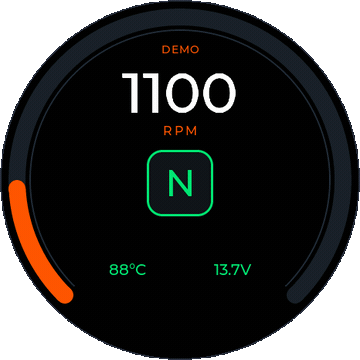
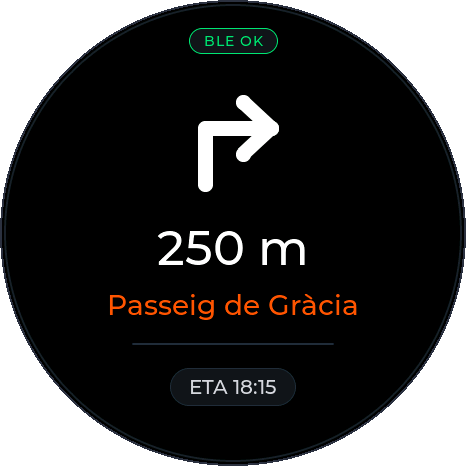
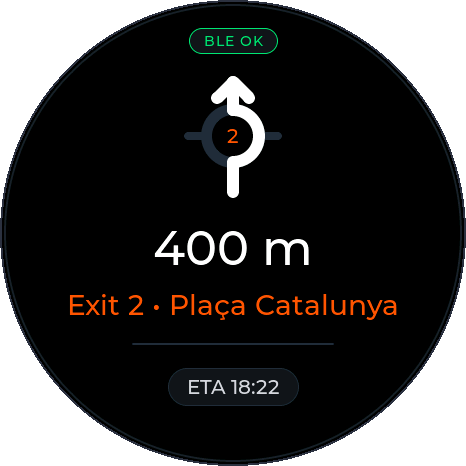
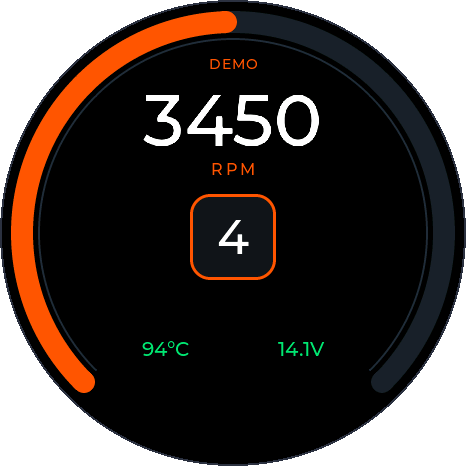
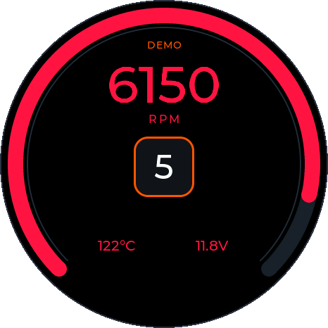
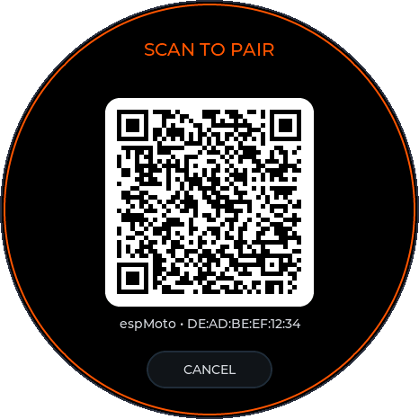

# espMoto (`M5Stack StopWatch C152`)

A minimalist motorcycle handlebar display built on the **M5Stack StopWatch (`C152`)** (`ESP32-S3R8`, 1.75" 466×466 round AMOLED), pairing turn-by-turn OpenStreetMap navigation from a companion Android app with live motorcycle OBD-II / ELM327 telemetry.

<p align="center">
  
</p>

## Screenshots

| Turn-by-Turn Navigation | Roundabout Exit | Telemetry (Cruise) | Telemetry (Redline) | QR Pairing |
| :---: | :---: | :---: | :---: | :---: |
|  |  |  |  |  |

## Features
1. **Turn-by-Turn Navigation (OpenStreetMap + OSRM):** Pure navigation focus with glanceable maneuver arrows (including European roundabout exit numbers & multi-exit diagrams), distance countdown, scrolling street name with European Latin diacritics support, ETA pill, and BLE connection status streamed from the Android companion app.
2. **Motorcycle Telemetry (BLE ELM327):** 270° configurable RPM tachometer arc with amber/redline alerts, center badge (gear / speed / throttle), and configurable bottom diagnostic slots (coolant/engine temperature, battery voltage, intake temp, oil pressure, lean angle, etc.). Supports standard Euro 4/5+ ISO 15765-4 CAN, UDS Service 22, J1850 VPW, and K-Line protocols configured dynamically from the companion app.
3. **QR Code BLE Pairing:** On-device pairing screen displaying a `espmoto://pair?...` QR code with a randomly generated 16-character token stored in NVS, authenticated on BLE session connect.
4. **Interactive LVGL Web Simulator (`simulator/`):** Compiles **LVGL v9.2** and hardware-agnostic `firmware/src/ui_renderer.cpp` into a native Linux shared library (`libespmoto_lvgl.so`) and renders the 466×466 round AMOLED framebuffer live in a browser with touch forwarding, telemetry controls, BLE payload injection, and hot-rebuild.

## Repository Structure
- `firmware/` — PlatformIO (`Arduino` + `M5Unified` + `M5GFX` + `LVGL v9.2` + `NimBLE-Arduino`) firmware for the M5Stack StopWatch (`C152`).
  - `firmware/src/ui_renderer.{h,cpp}` — Pure LVGL v9.2 UI renderer shared identically between ESP32-S3 firmware and the Web Simulator.
  - `firmware/src/ble_manager.{h,cpp}` — NimBLE GATT server handling QR pairing authentication, navigation packets, and dynamic OBD configuration persistence in NVS.
  - `firmware/src/elm327_client.{h,cpp}` — BLE GATT client for ELM327 adapters with dynamic AT/PID polling and backoff.
  - `firmware/src/obd_config.{h,cpp}` — Configurable OBD protocol, display layout slots, and custom PID formula evaluator.
  - `firmware/src/arduino_compat.h` — Host C++ compatibility shim (`String`, `millis`, `constrain`) when compiling outside Arduino.
  - `firmware/include/lv_conf.h` — LVGL v9.2 configuration (`LV_COLOR_DEPTH 16`, Montserrat 12–48 fonts, QR code generator, CLIB stdlib).
- `simulator/` — Native LVGL v9.2 Web Simulator (`sim_bridge.cpp`, `Makefile`, `server.py`, `index.html`).

## Building Firmware (PlatformIO)
```bash
cd firmware
pio run
```
`platformio.ini` pins `lvgl/lvgl @ 9.2.2`, `m5stack/M5Unified @ 0.2.15`, `m5stack/M5GFX @ 0.2.21`, and `h2zero/NimBLE-Arduino @ 2.1.0`.

## Running the LVGL Web Simulator
Optionally copy `.env.example` to `.env` to override the advertised host or port (defaults to `localhost:8152`):
```bash
cp .env.example .env
```

Build LVGL dependencies (via PlatformIO or `firmware/lib/lvgl`) and start the simulator:
```bash
make -C simulator -j4
python3 simulator/server.py --host 0.0.0.0
```
Open in browser: **http://localhost:8152** (or the `SIMULATOR_HOST` / `SIMULATOR_PORT` set in `.env`).

## Hardware Notes: Motorcycle OBD-II & BLE ELM327
- Because the `ESP32-S3` only supports **BLE** (not Bluetooth Classic SPP), you need a **BLE-capable ELM327 adapter** (e.g., Vgate iCar Pro BLE, OBDLink CX, Veepeak BLE) paired with the appropriate motorcycle diagnostic adapter cable (Euro 5 red 6-pin, 4-pin/6-pin manufacturer plug, or 4-pin Deutsch connector).
- Protocol (`ATSP0` auto, `ATSP6`/`ATSP7` CAN, `ATSP2` J1850 VPW, `ATSP3`/`ATSP5` K-Line) and custom UDS/Mode 21/Service 01 PIDs are configured from the companion Android app and synced over BLE.
- Note: Many cheap v2.1 ELM327 clones omit legacy protocols such as SAE J1850 VPW or K-Line; use a v1.4/v1.5-spec or OBDLink-class adapter if targeting pre-CAN motorcycles.

## Shared BLE Navigation & Config Protocol (Phone → StopWatch)
- **Device Name:** `espMoto`
- **Service UUID:** `4fafc201-1fb5-459e-8fcc-c5c9c331914b`
- **Nav Characteristic UUID (Write / Write Without Response):** `beb5483e-36e1-4688-b7f5-ea07361b26a8`
- **OBD Config Characteristic UUID (Write / Write Without Response / Read):** `beb5483e-36e1-4688-b7f5-ea07361b26a9`
- **Pairing Auth Characteristic UUID (Write / Read):** `beb5483e-36e1-4688-b7f5-ea07361b26aa`
- **Nav Payload Format (UTF-8 pipe-delimited):**
  ```text
  <active:0|1>|<maneuver_id:0-17>|<distance>|<street>|<eta>
  ```
  Example: `1|2|250 m|Passeig de Gràcia|18:15`

## Disclaimer
This is a **hobbyist project** created for personal experimentation and educational purposes:
- **Local Laws:** You are responsible for checking and complying with your local traffic and vehicle regulations regarding handlebar-mounted displays and navigation devices while riding.
- **OBD-II & Vehicle Risk:** Connecting an ELM327 adapter or sending OBD-II / UDS diagnostic queries to a motorcycle's diagnostic port is done entirely at your own risk. You are solely responsible for any electrical, ECU, or mechanical damage to your motorcycle.

## License
Licensed under the [MIT License](LICENSE).

